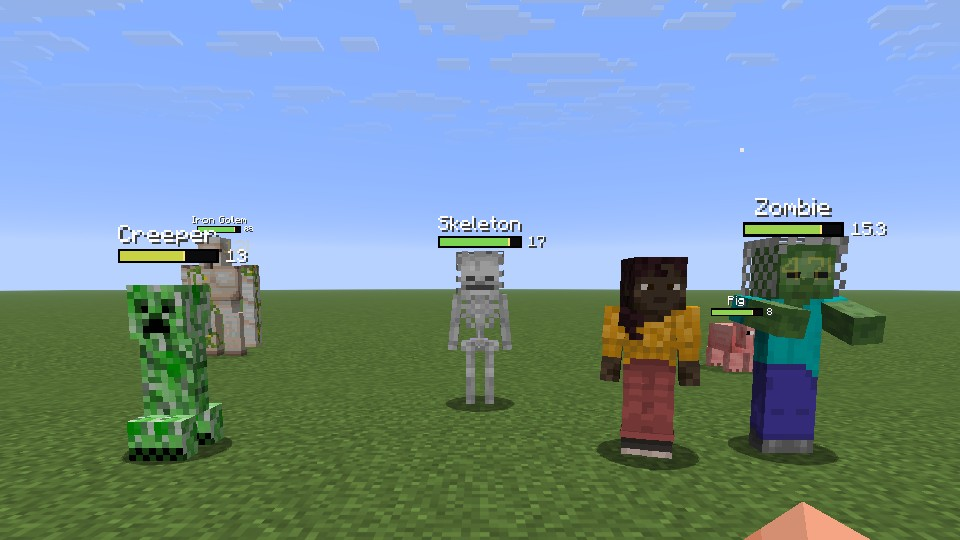
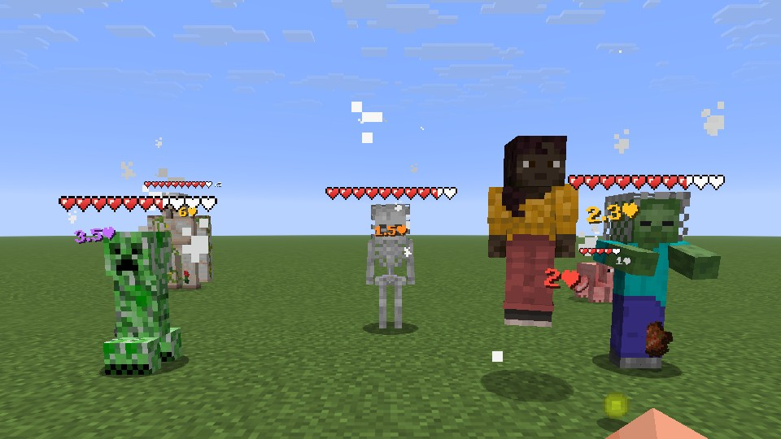
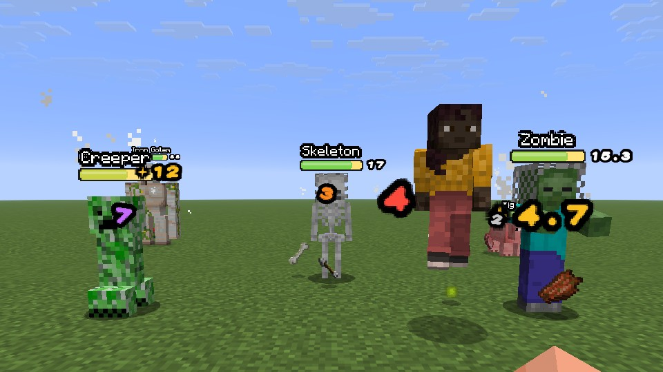
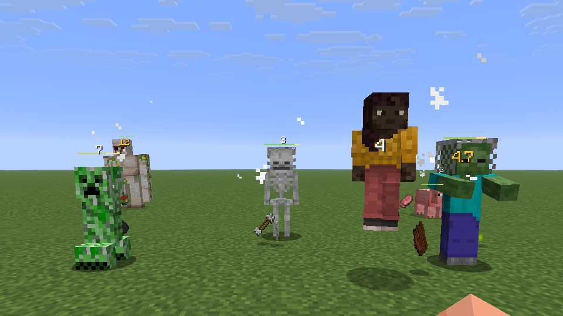
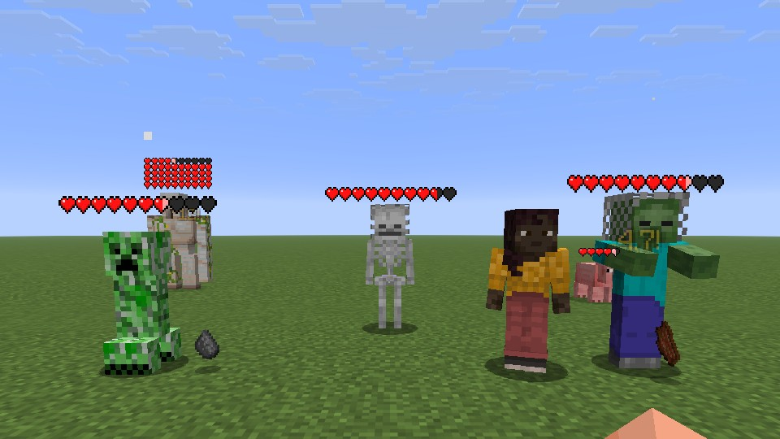
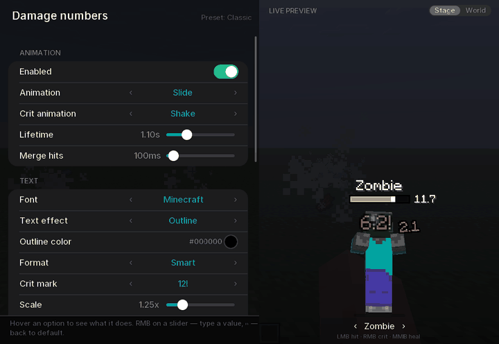
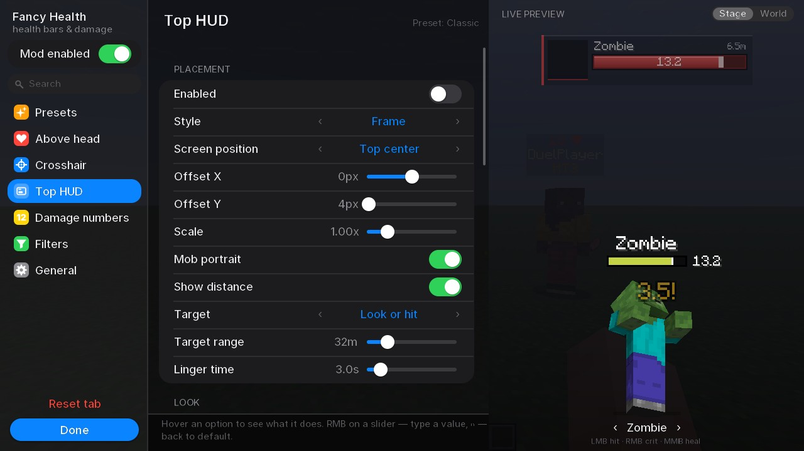
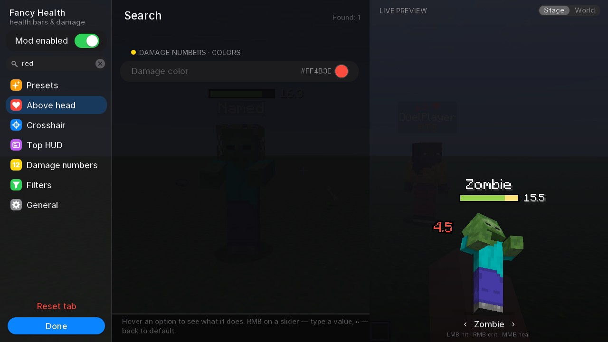

<p align="center">
  
</p>

<h1 align="center">Fancy Health Indicators</h1>

<p align="center">
  Health bars and floating damage numbers with a settings screen where every change shows up at once.<br>
  A client-side <b>Fabric</b> mod for <b>Minecraft 1.21.11, 26.2 and 26.3</b>. 18 languages.
</p>

<p align="center">
  <b>English</b> | <a href="README.ru.md">Русский</a>
</p>


Works on any server: everything is drawn on your side, the server doesn't need anything installed.

## Features

- **Health bars** above the head, above or below the nametag, on the body, under the crosshair, or as a target frame
  at the top of the screen.
- **The name above the bar** has its own size, font, color and effect.
- **Twelve bar styles**: flat, glossy, rounded, segmented, slanted, neon, MMO plate, thin line, hearts, hearts from the game HUD,
  scoreboard line under the nick (`20 ❤`, like the vanilla belowname) and text only.
- **Big mobs**: more than 10 hearts are shown in rows like the game HUD, as colored layers of 20 HP, or as one heart
  with a number. Poison, wither and freezing change the hearts like in the HUD.
- **HP drain**: the lost part of the bar holds for a moment and then drains away; the delay, speed and colors are yours.
  A hit flashes only the part that was lost.
- **Damage numbers**: pop, rise, fountain, bounce, zoom slam, shake, slide, spiral and a stacked log. Crits get their own
  animation, size, color and mark. Colors by damage type (fire, magic, fall…), quick hits merge into one number.
- **12 fonts** for bars and numbers, with shadow, outline, thick outline or glow.
- **11 presets**: Classic, MMO, Hearts, Game hearts, Scoreboard, Hologram, Arcade, Minimal, PvP, Boss bar, Comic.
  Each shows a live sample.
- **Live preview**: the mob on the right reacts to every change — pick an animation and a number flies out,
  move a slider and the bar moves. LMB hits, RMB crits, MMB heals.
- **Search** over all settings: by name, by value, by category, by color (`red`, `#ff0000`), by typos or a wrong
  keyboard layout, and `changed` for everything you changed.
- **Fair play**: no bars on invisible players and nothing through walls unless the nametag itself is visible there.
- **Server nametags**: bars move above custom nametags made of text displays and above the TAB line under the nick;
  player HP can be read from that line when the server hides the real one.
- **Zoom mods** (Zoomify, Ok Zoomer, Logical Zoom): bars and numbers keep the right size while zoomed.

## Presets

| | | |
|---|---|---|
|  Classic |  MMO |  Hologram |
|  Hearts |  Arcade |  PvP |
|  Comic |  Minimal |  Boss bar |
|  Game hearts |  Scoreboard | |

A preset is a starting point: change anything after it and the preset becomes "Custom".

## Settings

Open with `H` (Controls → Fancy Health Indicators) or through Mod Menu. The switch at the top turns the whole mod off,
and a separate key for that can be bound in the controls.




| | |
|---|---|
|  Presets |  Damage numbers |
|  Filters: click a mob on the right to turn it on or off |  Target frame |
|  Search |  Search by color |

- RMB on a slider — type a number, RMB on a color — type a hex code.
- `↺` next to a setting puts it back to the preset value.
- "Reset tab" resets the current tab, Shift + click resets everything; what will be reset is highlighted in green.
- Export and Import on the Presets tab copy the whole config as a short string through the clipboard.
- Settings that only work together with another one are dimmed, and changing them switches the other one on.

| | |
|---|---|
|  Bar under the crosshair and the target frame |  Bars above a server nametag |

## For server owners

The mod can be limited per server without any plugin: send one of these codes in a chat message, or put it into the server
MOTD. The codes are invisible, and a message made only of codes doesn't show up in chat at all.

| Code | Turns off |
|---|---|
| `§h§p§j` | the whole mod |
| `§h§p§g` | bars (above head, under the crosshair, target frame) |
| `§h§p§q` | damage numbers |
| `§h§p§s` | bars and numbers on other players |
| `§h§p§w` | bars behind walls, even when the nametag is visible there |
| `§h§p§z` | everything above, back on |

Codes can be combined in one message. They last until the player leaves the server, and the settings screen shows the
player what the server turned off.

Bukkit / Paper:

```java
@EventHandler
public void onJoin(PlayerJoinEvent event) {
    event.getPlayer().sendMessage("§h§p§s§h§p§q");
}
```

Other client mods can do the same through the API:

```java
FancyHealthApi.restrict("mymod", Restriction.PLAYERS, Restriction.NUMBERS);
FancyHealthApi.clear("mymod");
```

## Updates

When a new version is out on Modrinth, a small card shows up in the corner of the settings screen with Download, Hide and
Don't remind. The check is one request to the Modrinth API when the settings are opened for the first time; it can be
turned off in General.

## Install

1. Install [Fabric Loader](https://fabricmc.net/use/installer/) and [Fabric API](https://modrinth.com/mod/fabric-api).
2. Put the jar for your Minecraft version into `mods`.

| Jar | Minecraft | Java |
|---|---|---|
| `fancyhealth-1.21.11-1.0.0.jar` | 1.21.11 | 21+ |
| `fancyhealth-26.2-1.0.0.jar` | 26.2 | 25+ |
| `fancyhealth-26.3-1.0.0.jar` | 26.3 | 25+ |

[Mod Menu](https://modrinth.com/mod/modmenu) is optional.

The config is `config/fancyhealth.json`.

## Languages

en, ru, uk, de, fr, es, pt, it, pl, tr, nl, cs, sv, zh, ja, ko, vi, id. The mod follows the game language.

## Build

JDK 25. Shared code is in `common/`, version-specific code in `versions/<version>/`.

```bash
cd versions/1.21.11 && ./gradlew build
cd versions/26.2 && ./gradlew build
cd versions/26.3 && ./gradlew build
```

Jars end up in `versions/<version>/build/libs`.

## License

[MIT](LICENSE). Use it however and wherever you like; the only ask is to keep a link to this repository and the author's
nickname, **BbIJABNPOBATEJb**.
