<p align="center">
  
</p>

<h1 align="center">Fancy Health Indicators</h1>

<p align="center">
  Полосы здоровья и всплывающие цифры урона с настройками, где каждое изменение видно сразу.<br>
  Клиентский мод для <b>Fabric</b>, <b>Minecraft 1.21.11, 26.2 и 26.3</b>. 18 языков.
</p>

<p align="center">
  <a href="README.md">English</a> | <b>Русский</b>
</p>

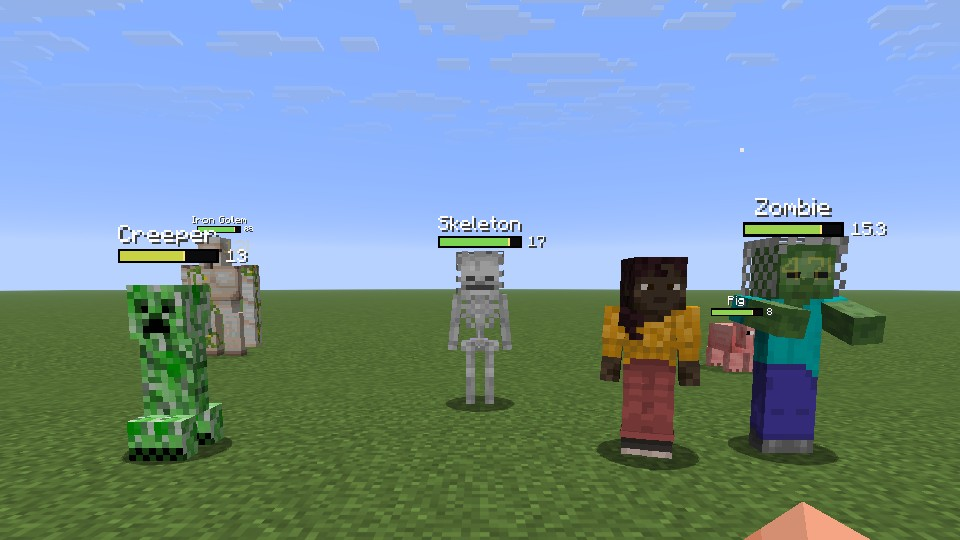

Работает на любом сервере: всё рисуется у тебя, серверу ничего ставить не нужно.

## Возможности

- **Полосы здоровья** над головой, над ником или под ним, на теле, под прицелом или рамкой цели сверху экрана.
- **Имя над полосой**: свой размер, шрифт, цвет и эффект.
- **Десять стилей полосы**: плоская, глянец, скруглённая, сегменты, скошенная, неон, MMO-плашка, линия, сердечки, только текст.
- **Утекание HP**: потерянная часть полосы держится мгновение и утекает; задержка, скорость и цвета настраиваются.
  При ударе вспыхивает только потерянная часть.
- **Цифры урона**: хлопок, подъём, фонтан, прыжок, зум-удар, тряска, сдвиг, спираль и столбик. У крита своя анимация,
  размер, цвет и метка. Цвет по типу урона (огонь, магия, падение…), быстрые удары склеиваются в одну цифру.
- **12 шрифтов** для полос и цифр, с тенью, обводкой, жирной обводкой или свечением.
- **9 пресетов**: Классика, MMO, Сердечки, Голограмма, Аркада, Минимал, PvP, Босс-бар, Комикс. У каждого живой пример.
- **Живой предпросмотр**: моб справа реагирует на каждое изменение — выбрал анимацию, и вылетела цифра,
  двинул слайдер — сдвинулась полоса. ЛКМ — удар, ПКМ — крит, СКМ — лечение.
- **Поиск** по всем настройкам: по названию, по значению, по категории, по цвету (`красный`, `#ff0000`), с опечатками
  и в неправильной раскладке, а `изменённые` покажет всё, что ты поменял.
- **Честная игра**: невидимых не показывает, сквозь стены — только если там виден сам ник.
- **Серверные ники**: полоса встаёт над ником из текстовых дисплеев и над строкой TAB под ником; HP игроков можно брать
  из этой строки, если сервер прячет настоящее.
- **Моды на зум** (Zoomify, Ok Zoomer, Logical Zoom): при приближении полосы и цифры остаются правильного размера.

## Пресеты

| | | |
|---|---|---|
|  Классика | 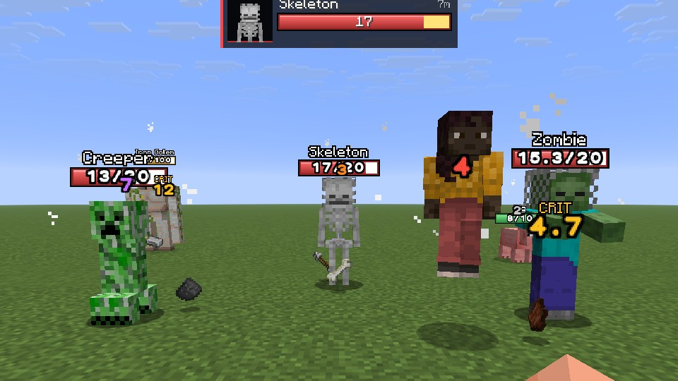 MMO | 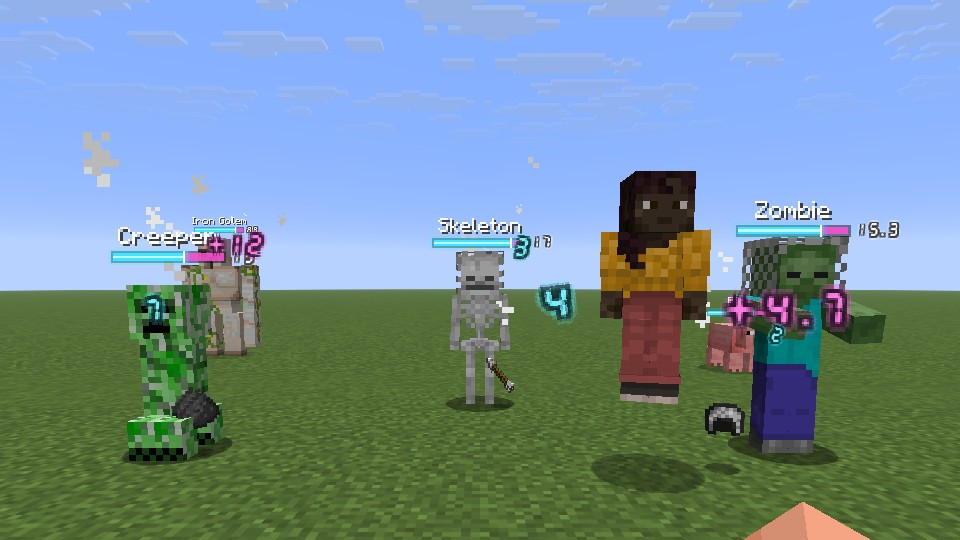 Голограмма |
| 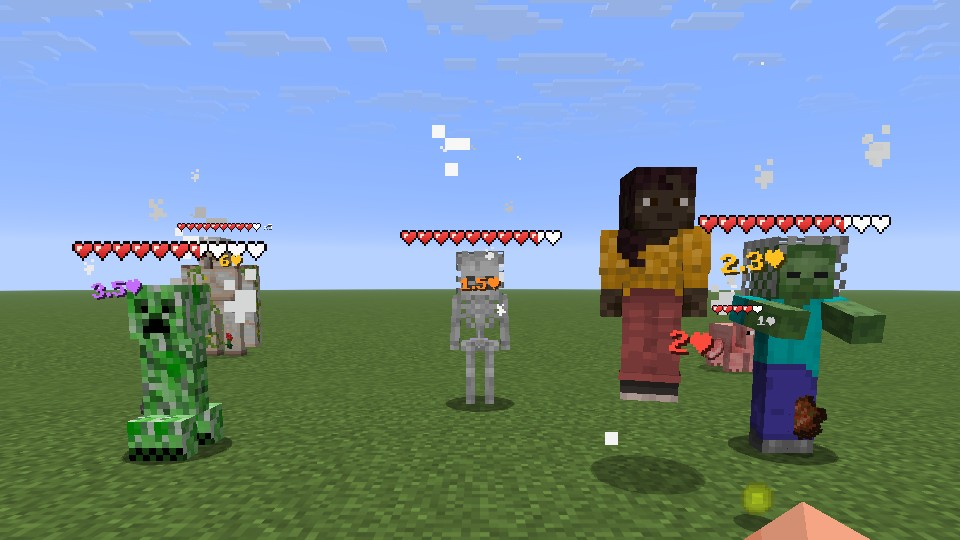 Сердечки | 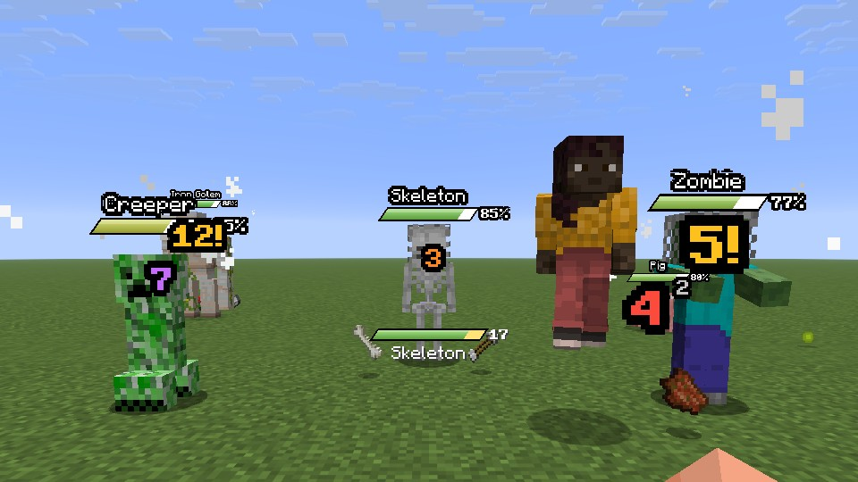 Аркада | 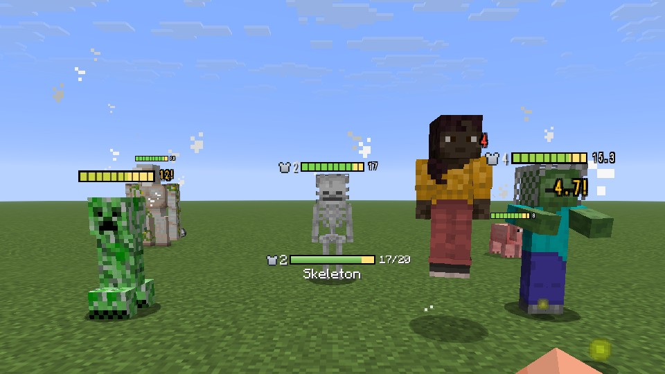 PvP |
| 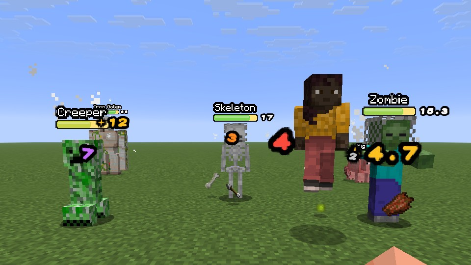 Комикс | 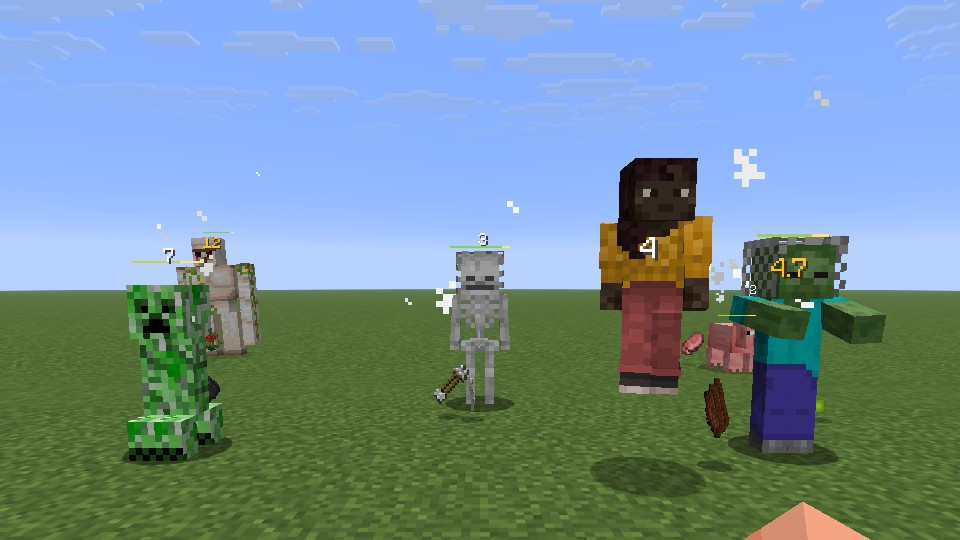 Минимал | 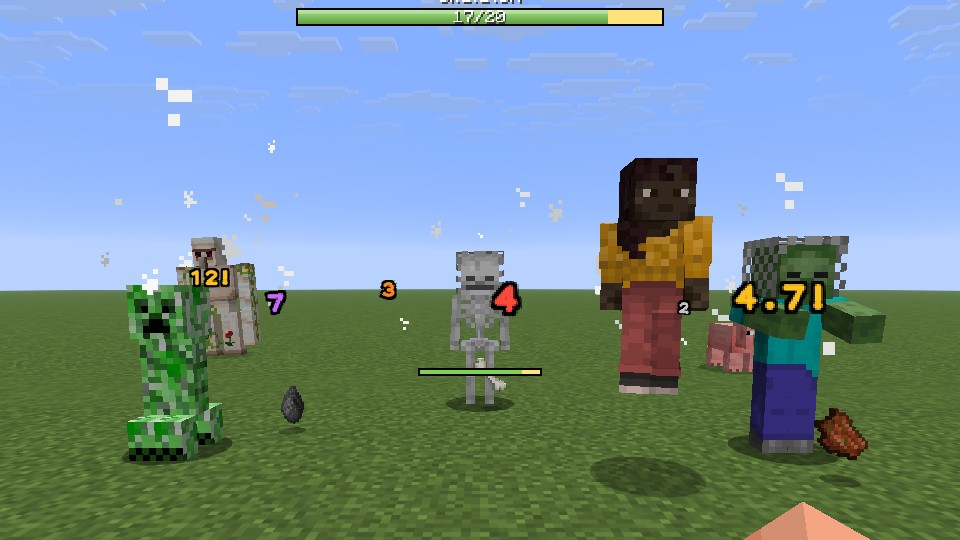 Босс-бар |

Пресет — это отправная точка: поменяй что угодно, и он станет «Своим».

## Настройки

Открываются на `H` (Управление → Fancy Health Indicators) или через Mod Menu. Переключатель сверху выключает весь мод,
для этого же можно назначить отдельную клавишу.

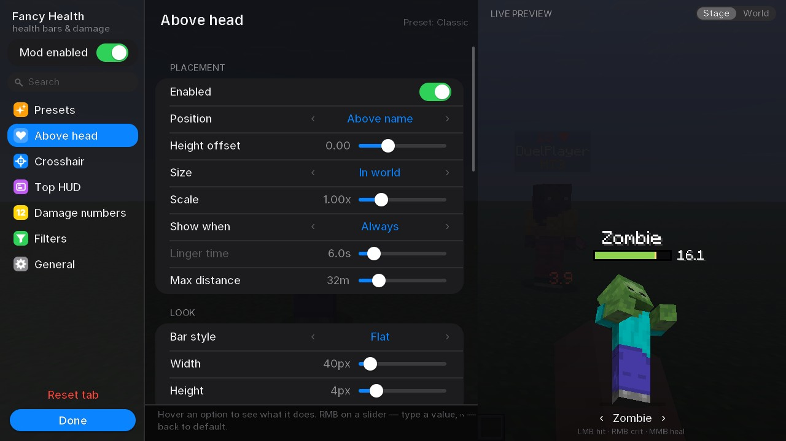

| | |
|---|---|
| 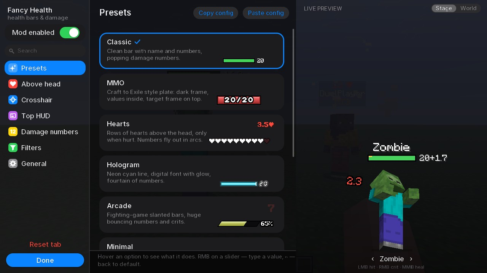 Пресеты | 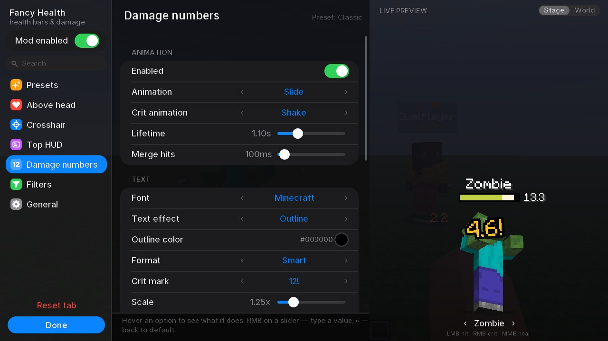 Цифры урона |
| 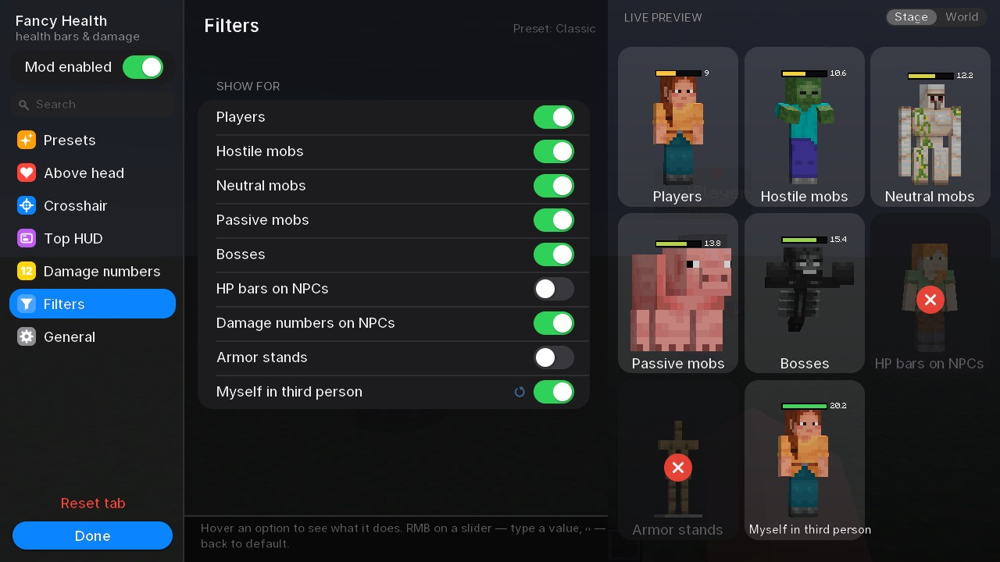 Фильтры: клик по мобу справа включает и выключает его | 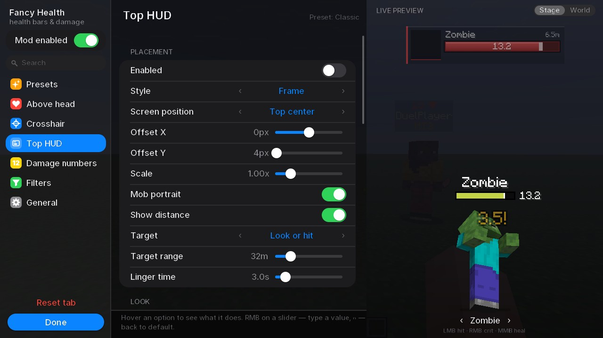 Рамка цели |
| 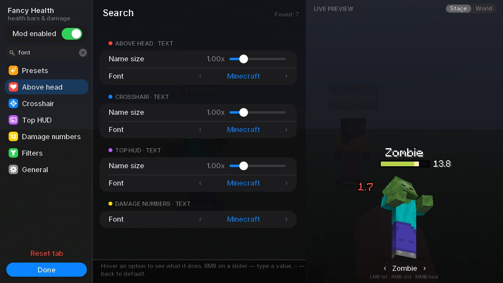 Поиск | 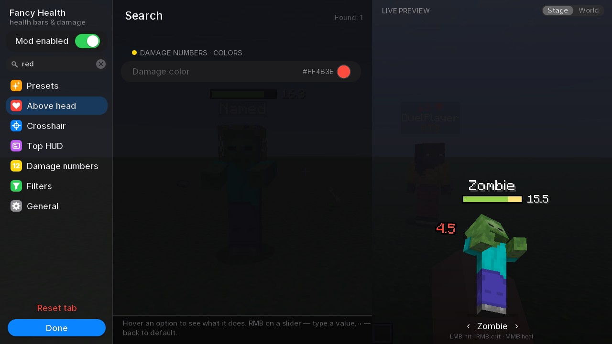 Поиск по цвету |

- ПКМ по слайдеру — ввести число, ПКМ по цвету — ввести hex.
- `↺` рядом с настройкой возвращает значение пресета.
- «Сбросить» сбрасывает текущую вкладку, Shift + клик — всё; что сбросится, подсвечивается зелёным.
- Экспорт и импорт на вкладке пресетов переносят весь конфиг короткой строкой через буфер обмена.
- Настройки, которые работают только вместе с другой, приглушены, а их изменение само включает нужную.

| | |
|---|---|
| 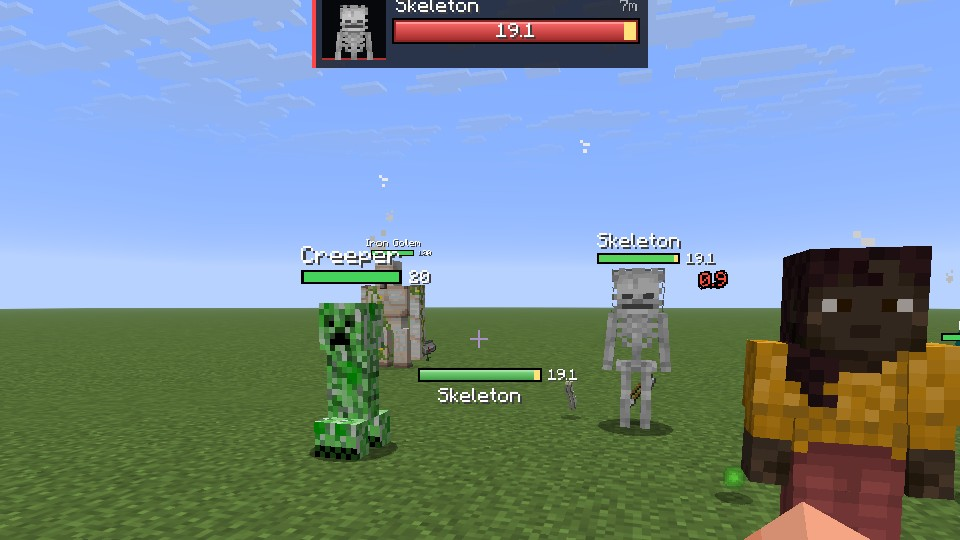 Полоса под прицелом и рамка цели | 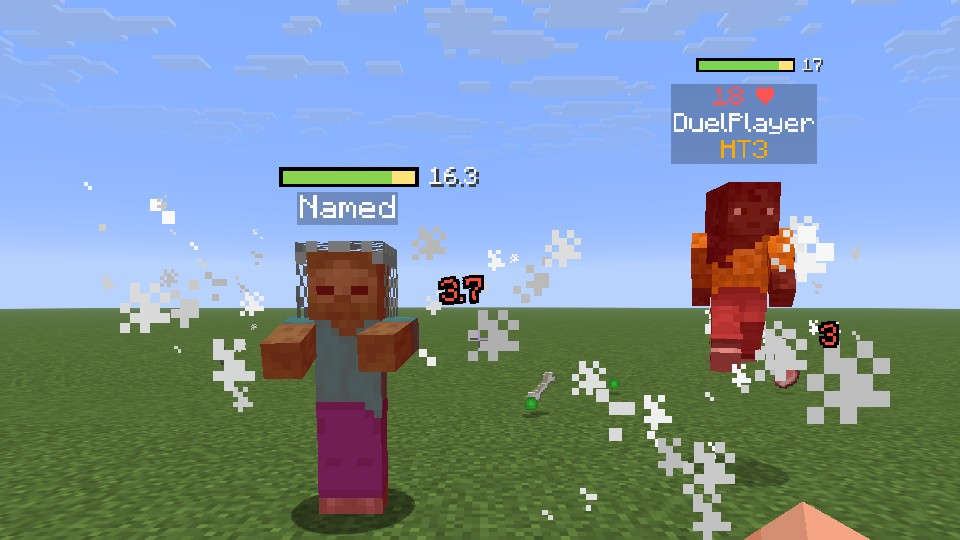 Полосы над серверным ником |

## Установка

1. Поставь [Fabric Loader](https://fabricmc.net/use/installer/) и [Fabric API](https://modrinth.com/mod/fabric-api).
2. Положи jar под свою версию в `mods`.

| Jar | Minecraft | Java |
|---|---|---|
| `fancyhealth-1.21.11-1.0.0.jar` | 1.21.11 | 21+ |
| `fancyhealth-26.2-1.0.0.jar` | 26.2 | 25+ |
| `fancyhealth-26.3-1.0.0.jar` | 26.3 | 25+ |

[Mod Menu](https://modrinth.com/mod/modmenu) — по желанию.

Конфиг лежит в `config/fancyhealth.json`.

## Языки

en, ru, uk, de, fr, es, pt, it, pl, tr, nl, cs, sv, zh, ja, ko, vi, id. Мод берёт язык игры.

## Сборка

JDK 25. Общий код в `common/`, код под версию — в `versions/<версия>/`.

```bash
cd versions/1.21.11 && ./gradlew build
cd versions/26.2 && ./gradlew build
cd versions/26.3 && ./gradlew build
```

Jar-файлы появятся в `versions/<версия>/build/libs`.

## Лицензия

[MIT](LICENSE). Используй как угодно и где угодно; единственная просьба — сохранить ссылку на этот репозиторий
и ник автора, **BbIJABNPOBATEJb**.
